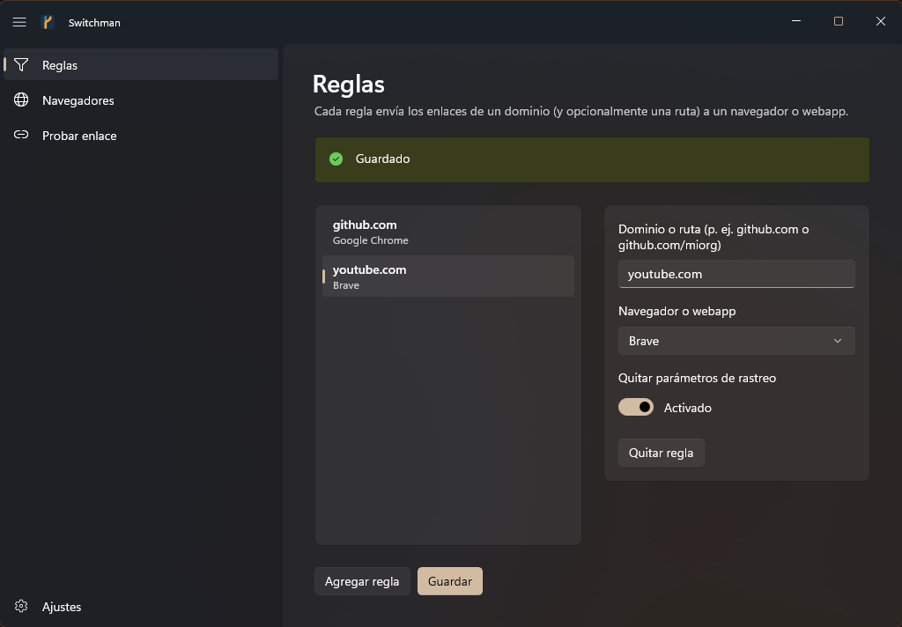
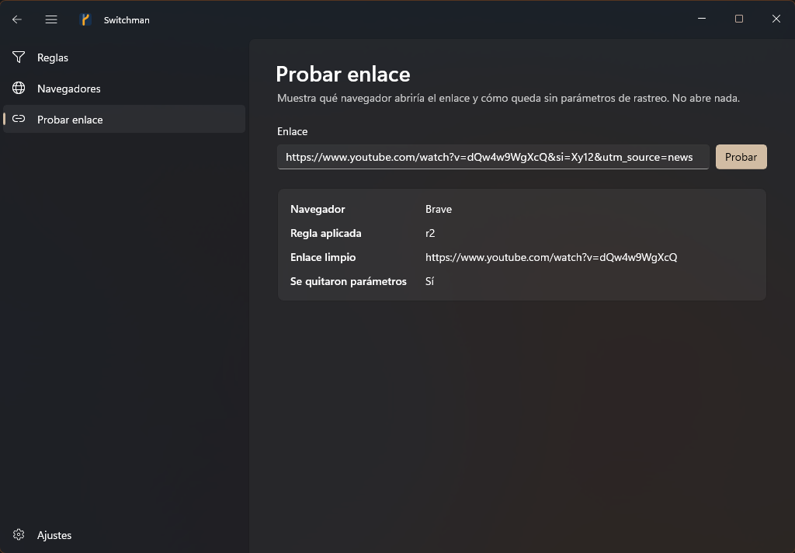

<p align="center">
  
</p>

<h1 align="center">Switchman</h1>

<p align="center">
  <a href="README.md">English</a> · <b>Español</b>
</p>

<p align="center">
  Cada enlace que abres en Windows pasa primero por Switchman: le quita los parámetros de
  rastreo y lo envía al navegador que le corresponde.
</p>

---

El *switchman* es el guardagujas del ferrocarril: acciona la aguja que decide por qué vía sigue el
tren. Switchman hace lo mismo con tus enlaces. Se registra como navegador predeterminado, así que
cuando haces clic en un enlace en Slack, Outlook, un PDF o cualquier otra aplicación, Windows se lo
entrega a Switchman, que:

1. **Lo limpia**: quita `utm_*`, `fbclid`, `gclid`, `si` y otros parámetros de rastreo, y deja el
   resto exactamente como estaba (sin recodificar).
2. **Lo enruta**: elige el navegador según tus reglas (`github.com` → Chrome, `youtube.com` → Brave…)
   o usa tu navegador por defecto.
3. **Lo abre** en ese navegador y termina. No queda nada corriendo en segundo plano.

Sin acceso a la red, sin telemetría, sin cuentas. Tu configuración es un archivo JSON local.

| Reglas | Probar enlace |
| :---: | :---: |
|  |  |

## Qué ofrece

- **Reglas por dominio**, con ruta opcional: `github.com`, `docs.google.com/document`. Una regla
  aplica al dominio y sus subdominios (`gist.github.com`), nunca a dominios parecidos (`notgithub.com`).
- **Limpieza de rastreo** activada por defecto; se puede apagar en general o por regla, y puedes
  agregar parámetros propios.
- **Detección de navegadores**: Edge, Chrome, Brave, Firefox, Zen, Helium y cualquier navegador
  registrado en Windows. Otros se agregan a mano en `config.json` (`custom_browsers`).
- **Respaldos seguros**: si `config.json` falta o está dañado, los enlaces se siguen abriendo en el
  navegador de respaldo que elegiste (o en el primero detectado). Una config rota nunca te deja sin
  navegador.
- **Webapps instaladas como destino**: las apps instaladas desde un navegador Chromium (Helium, Chrome,
  Edge, Brave → *Instalar app*) aparecen junto a los navegadores, p. ej. "Instagram (app de Helium)". Una
  regla `instagram.com` → esa app abre el enlace **dentro de la ventana de la app**, no en una pestaña.
- **Apps de escritorio por deep link**: los enlaces de WhatsApp, Discord, Teams, Telegram, Zoom, Slack, Spotify o
  Notion se abren en su app de escritorio (un interruptor por app), y puedes agregar deep links para cualquier
  otra app que registre un protocolo.
- **Probar sin abrir**: muestra a qué navegador iría un enlace y cómo queda limpio.
- **Ediciones a salvo**: si `config.json` cambia con la app abierta (a mano o desde otra ventana),
  la app pregunta si recargar o sobrescribir, en vez de descartar en silencio una de las versiones.
- **Instalación por usuario**: sin permisos de administrador; todo vive en `HKCU` y `%LOCALAPPDATA%`.

### Parámetros de rastreo que se quitan

Cualquier parámetro que empiece con `utm_`, y además:
`fbclid` `igshid` `igsh` `gclid` `gclsrc` `dclid` `gbraid` `wbraid` `srsltid` `msclkid` `twclid`
`ttclid` `li_fat_id` `yclid` `mc_cid` `mc_eid` `_hsenc` `_hsmi` `mkt_tok` `vero_id` `wickedid`
`oly_anon_id` `oly_enc_id` `rb_clickid` `s_cid` `si`.

Puedes agregar los tuyos en **Ajustes → Parámetros extra a quitar**.

## Instalación

**Requisitos:** Windows 10 (1809) o Windows 11, de 64 bits. Nada más: .NET y el Windows App SDK
vienen incluidos en el paquete.

1. Descarga `Switchman-<versión>-win-x64.zip` desde la [última versión](../../releases/latest).
2. Clic derecho en el zip → **Propiedades** → marca **Desbloquear** → **Aceptar**. Windows marca los
   archivos descargados y, sin este paso, PowerShell no deja ejecutar el instalador.
3. Descomprime el zip, abre una terminal en esa carpeta y ejecuta:
   ```powershell
   powershell -ExecutionPolicy Bypass -File .\install.ps1
   ```
   El instalador copia Switchman en `%LOCALAPPDATA%\Programs\Switchman`, lo agrega al menú Inicio y
   lo registra como navegador. Al final se abre **Configuración → Aplicaciones predeterminadas**.
4. Abre **Switchman** desde el menú Inicio, entra a **Navegadores**, elige tu navegador por defecto
   (y, si quieres, uno de respaldo) y pulsa **Guardar**. Agrega las **Reglas** que quieras.
5. En **Configuración → Aplicaciones predeterminadas**, busca **Switchman** y pulsa **Establecer
   como predeterminado**. Windows solo deja que esa elección la hagas tú; ninguna app puede hacerla
   por ti.

Desde ese momento todos los enlaces pasan por Switchman. La página **Ajustes** de la app indica si
Switchman es el navegador predeterminado.

> **SmartScreen:** los ejecutables todavía no están firmados, así que la primera vez Windows puede
> mostrar "Windows protegió su PC". Pulsa **Más información → Ejecutar de todas formas**.

### Actualizar

Descarga la nueva versión y vuelve a ejecutar `install.ps1`. Tu configuración se conserva.

### Desinstalar

```powershell
powershell -ExecutionPolicy Bypass -File "$env:LOCALAPPDATA\Programs\Switchman\install.ps1" -Uninstall
```

Quita el registro, el acceso directo del menú Inicio y la carpeta del programa. Tu configuración en
`%LOCALAPPDATA%\Switchman` se conserva por si reinstalas; borra esa carpeta si también quieres
eliminarla. Después elige otro navegador predeterminado en la Configuración de Windows.

## Uso

| Página | Para qué sirve |
| --- | --- |
| **Reglas** | Dominio o ruta → navegador, y si se quita el rastreo en esa regla. |
| **Navegadores** | Navegador por defecto (enlaces sin regla) y de respaldo (si `config.json` falta o está dañado). |
| **Probar enlace** | Pega un enlace y ve el navegador, la regla aplicada y el enlace limpio. No abre nada. |
| **Ajustes** | Limpieza de rastreo, parámetros extra y el estado del navegador predeterminado de Windows. |

### Abrir enlaces en webapps instaladas

Instala el sitio como app desde tu navegador Chromium (*Instalar app* / *Instalar este sitio como
aplicación*). Switchman la encuentra en el menú Inicio y la muestra en **Navegadores**, así que puedes
elegirla en una regla: `instagram.com` → **Instagram (app de Helium)**. Cada enlace se abre en una
ventana nueva de esa app.

Por dentro, la app se lanza así:
`chrome_proxy.exe --profile-directory=Default --app-id=<id> --app-launch-url-for-shortcuts-menu-item=<url>`.
El mismo marcador `{url}` sirve en tus `custom_browsers`: si un argumento contiene `{url}`, el enlace va
ahí; si no, se agrega al final.

### Abrir enlaces en apps de escritorio (deep links)

Muchas apps (WhatsApp de la Microsoft Store, apps de Electron como Discord, Teams…) registran un protocolo
propio (`whatsapp:`, `discord:`…). En la página **Apps** cada app instalada del catálogo integrado tiene un
interruptor; activado, sus enlaces web se traducen y se abren en la app:

| Enlace web | Se abre como |
| --- | --- |
| `wa.me/<número>?text=…`, `api.whatsapp.com/send?phone=…` | `whatsapp://send?phone=…&text=…` |
| `chat.whatsapp.com/<código>` | `whatsapp://chat?code=<código>` |
| `discord.gg/<código>`, `discord.com/channels/…` | `discord://-/invite/<código>`, `discord://-/channels/…` |
| `teams.microsoft.com/l/…` | `msteams:/l/…` |
| `t.me/<usuario>`, `t.me/+<invitación>` | `tg://resolve?domain=<usuario>`, `tg://join?invite=<invitación>` |
| `zoom.us/j/<id>?pwd=…` | `zoommtg://zoom.us/join?action=join&confno=<id>&pwd=…` |
| `app.slack.com/client/<equipo>/<canal>` | `slack://channel?team=…&id=…` |
| `open.spotify.com/<tipo>/<id>` | `spotify:<tipo>:<id>` |
| `notion.so/…` | `notion://www.notion.so/…` |

Tus reglas van primero, los parámetros de rastreo se quitan antes de traducir, y un enlace sin forma de app
(por ejemplo `wa.me/message/…`) se abre en el navegador como siempre. **Buscar apps** vuelve a revisar el
sistema: las apps del catálogo recién instaladas aparecen con su interruptor, y los demás protocolos
instalados se listan para que crees tu propio deep link: dominios + una plantilla como
`steam://openurl/{url}` (marcadores `{url}`, `{host}`, `{path}`, `{query}`).

### Archivos

Todo vive en `%LOCALAPPDATA%\Switchman`:

| Archivo | Contenido |
| --- | --- |
| `config.json` | Reglas, navegador por defecto, opciones de limpieza y navegadores personalizados. |
| `fallback.json` | Navegador a usar si `config.json` no se puede leer. |
| `switchman.log` | Una línea por enlace abierto (navegador, regla, si se limpió; nunca la URL). |
| `switchman-ui.log` | Eventos y errores de la app. |

### Línea de comandos

`switchman-cli.exe` es lo que Windows ejecuta en cada clic. La app también lo usa para todo lo demás:

```text
switchman-cli open-url <URL>            limpia, enruta y abre (lo que llama Windows)
switchman-cli test-url <URL>            la misma decisión en JSON, sin abrir nada
switchman-cli detect                    navegadores detectados en JSON
switchman-cli get-config                config.json con su revisión
switchman-cli set-config --revision R   guarda la config de stdin si nadie la cambió desde la revisión R
switchman-cli reset-config              aparta un config.json dañado como config.json.bak
switchman-cli set-fallback <ID>         fija el navegador de respaldo
switchman-cli status                    estado del registro y del navegador predeterminado
switchman-cli apps                      catálogo de deep links, deep links propios y otros protocolos instalados
switchman-cli register | unregister     registra en Windows o quita el registro (HKCU)
```

Códigos de salida: `0` ok, `1` error, `2` uso incorrecto, `3` config dañada, `4` la config cambió
desde que se leyó.

## Compilar desde el código

Requisitos:

- [Rust](https://rustup.rs) (stable, toolchain MSVC).
- Visual Studio Build Tools 2026 con **Desarrollo para el escritorio con C++**, **Herramientas de
  compilación para escritorio de .NET** y **Herramientas de compilación de desarrollo de aplicaciones
  de WinUI**.
- SDK de .NET 10.

```powershell
# Compilar e instalar desde el código
powershell -ExecutionPolicy Bypass -File .\scripts\install.ps1

# Verificaciones
cargo clippy --workspace --all-targets -- -D warnings
cargo test --workspace
dotnet test ui\Switchman.slnx

# Zip del release -> target\dist\Switchman-<versión>-win-x64.zip
powershell -ExecutionPolicy Bypass -File .\scripts\package.ps1
```

### Publicar una versión

Cambia `version` en `Cargo.toml` (`[workspace.package]`) y haz push a `main`. El
[workflow Release](.github/workflows/release.yml) compila en Windows, corre clippy y todos los tests, arma
el zip y publica el release `v<versión>`. Si ese tag ya existe, no hace nada. También se puede lanzar a mano
desde **Actions → Release** con `dry_run`, que deja el zip como artefacto sin publicar.

### Estructura

```text
core/       biblioteca Rust: limpieza de rastreo, reglas, config, detección de navegadores, registro
cli/        switchman-cli.exe, el programa registrado como navegador
ui/         app WinUI 3 (C#): Switchman.Core (ViewModels, testeable), Switchman.App, Switchman.Tests
assets/     ícono (SVG e ICO)
scripts/    install.ps1 y package.ps1
```

La app nunca lee ni escribe los JSON por su cuenta: pasa por `switchman-cli`, así la validación vive
en un solo lugar (Rust) y la app y el manejador de clics siempre coinciden.
