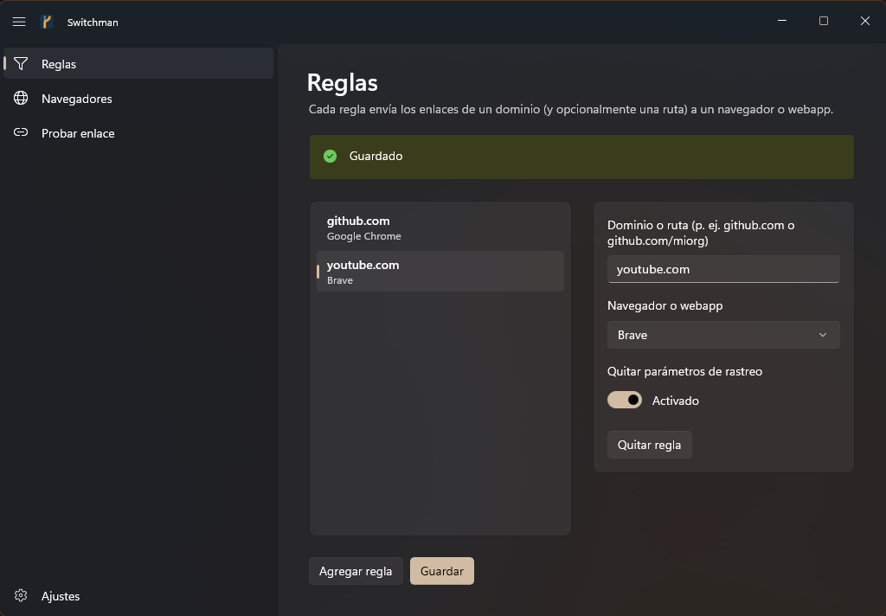
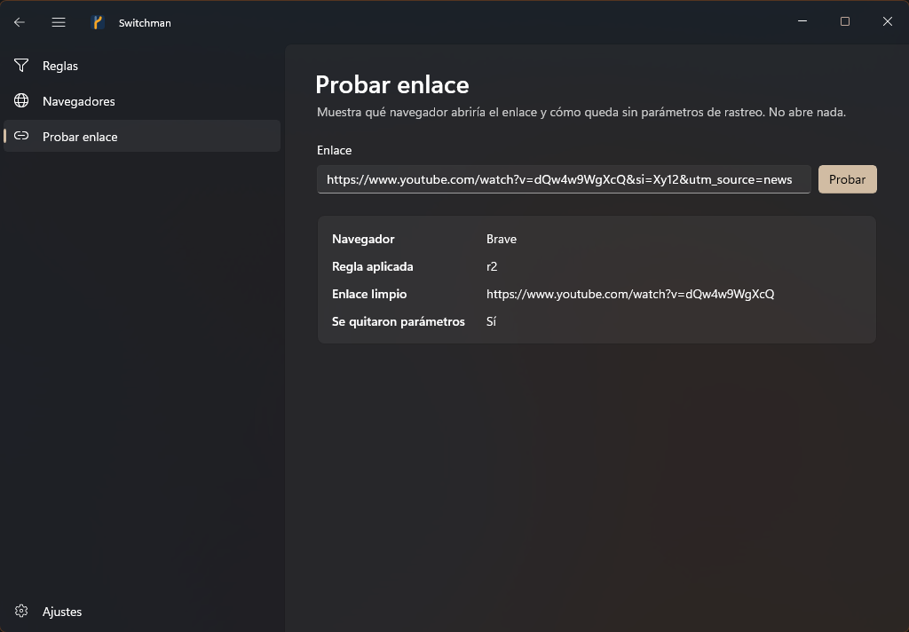

<p align="center">
  
</p>

<h1 align="center">Switchman</h1>

<p align="center">
  <b>English</b> · <a href="README.es.md">Español</a>
</p>

<p align="center">
  Every link you click on Windows goes through Switchman first: it strips the tracking
  parameters and sends the link to the browser it belongs in.
</p>

---

A railway *switchman* operates the points that decide which track a train takes. Switchman does
the same with your links. It registers itself as the default browser, so when you click a link in
Slack, Outlook, a PDF or any other app, Windows hands it to Switchman. Switchman then:

1. **Cleans it**: removes `utm_*`, `fbclid`, `gclid`, `si` and other tracking parameters, keeping
   everything else exactly as it was (no re-encoding).
2. **Routes it**: picks the browser from your rules (`github.com` → Chrome, `youtube.com` → Brave…)
   or your default browser.
3. **Opens it** in that browser and exits. Nothing stays running in the background.

No network access, no telemetry, no account. Your configuration is a local JSON file.

| Rules | Test a link |
| :---: | :---: |
|  |  |

## Features

- **Per-domain rules**, with an optional path: `github.com`, `docs.google.com/document`. A rule
  matches the domain and its subdomains (`gist.github.com`), never look-alikes (`notgithub.com`).
- **Tracking cleanup** on by default, switchable globally or per rule, with your own extra parameters.
- **Browser detection**: Edge, Chrome, Brave, Firefox, Zen, Helium and any browser registered in
  Windows. Others can be added by hand in `config.json` (`custom_browsers`).
- **Safe fallbacks**: if `config.json` is missing or damaged, links still open, in the fallback
  browser you chose (or the first one detected). A broken config never leaves you without a browser.
- **Test without opening**: see which browser a link would go to and what the clean URL looks like.
- **Edit-safe**: if `config.json` changes while the app is open (by hand or another window), the app
  asks whether to reload or overwrite instead of silently discarding either version.
- **Per-user install**: no administrator rights, everything lives under `HKCU` and `%LOCALAPPDATA%`.

### Tracking parameters removed

Any parameter starting with `utm_`, plus:
`fbclid` `igshid` `igsh` `gclid` `gclsrc` `dclid` `gbraid` `wbraid` `srsltid` `msclkid` `twclid`
`ttclid` `li_fat_id` `yclid` `mc_cid` `mc_eid` `_hsenc` `_hsmi` `mkt_tok` `vero_id` `wickedid`
`oly_anon_id` `oly_enc_id` `rb_clickid` `s_cid` `si`.

You can add your own in **Ajustes → Parámetros extra a quitar** (Settings → Extra parameters).

## Installation

**Requirements:** Windows 10 (1809) or Windows 11, 64-bit. Nothing else: .NET and the Windows App
SDK ship inside the package.

1. Download `Switchman-<version>-win-x64.zip` from the
   [latest release](../../releases/latest).
2. Right-click the zip → **Properties** → tick **Unblock** → **OK**. Windows marks downloaded files,
   and without this step PowerShell refuses to run the installer.
3. Extract the zip, open a terminal in that folder and run:
   ```powershell
   powershell -ExecutionPolicy Bypass -File .\install.ps1
   ```
   The installer copies Switchman to `%LOCALAPPDATA%\Programs\Switchman`, adds it to the Start menu
   and registers it as a browser. Windows **Settings → Default apps** opens at the end.
4. Open **Switchman** from the Start menu, go to **Navegadores** (Browsers), pick your default browser
   (and, optionally, a fallback) and click **Guardar** (Save). Add any **Reglas** (Rules) you want.
5. In **Settings → Default apps**, search for **Switchman** and click **Set default**. Windows
   only lets you make this choice yourself; no app can do it for you.

From now on every link goes through Switchman. The app's **Ajustes** (Settings) page shows whether
Switchman is the default browser.

> **SmartScreen:** the executables are not code-signed yet, so Windows may show "Windows protected
> your PC" the first time. Click **More info → Run anyway**.

### Updating

Download the new release and run `install.ps1` again. Your configuration is kept.

### Uninstalling

```powershell
powershell -ExecutionPolicy Bypass -File "$env:LOCALAPPDATA\Programs\Switchman\install.ps1" -Uninstall
```

This removes the registration, the Start menu shortcut and the program folder. Your configuration
in `%LOCALAPPDATA%\Switchman` stays, in case you reinstall. Delete that folder to remove it too.
Then pick another default browser in Windows Settings.

## Using it

The interface is in Spanish; English names are given in brackets.

| Page | What it is for |
| --- | --- |
| **Reglas** (Rules) | Domain or path → browser, and whether to strip tracking for that rule. |
| **Navegadores** (Browsers) | Default browser (links with no rule) and fallback browser (used if `config.json` is missing or damaged). |
| **Probar enlace** (Test link) | Paste a link and see the browser, the rule applied and the clean URL. Nothing is opened. |
| **Ajustes** (Settings) | Tracking cleanup on/off, extra parameters, and the Windows default-browser status. |

### Files

Everything lives in `%LOCALAPPDATA%\Switchman`:

| File | Content |
| --- | --- |
| `config.json` | Rules, default browser, cleanup options, custom browsers. |
| `fallback.json` | Browser to use if `config.json` cannot be read. |
| `switchman.log` | One line per opened link (browser, rule, whether it was cleaned; never the URL). |
| `switchman-ui.log` | App events and errors. |

### Command line

`switchman-cli.exe` is what Windows runs on every click. The app uses it for everything else too:

```text
switchman-cli open-url <URL>            clean, route and open (what Windows calls)
switchman-cli test-url <URL>            same decision as JSON, without opening anything
switchman-cli detect                    detected browsers as JSON
switchman-cli get-config                config.json with its revision
switchman-cli set-config --revision R   save config from stdin if nobody changed it since revision R
switchman-cli reset-config              move a damaged config.json aside as config.json.bak
switchman-cli set-fallback <ID>         set the fallback browser
switchman-cli status                    registration and default-browser status
switchman-cli register | unregister     register in / remove from Windows (HKCU)
```

Exit codes: `0` ok, `1` error, `2` usage, `3` damaged config, `4` config changed since it was read.

## Building from source

Requirements:

- [Rust](https://rustup.rs) (stable, MSVC toolchain).
- Visual Studio Build Tools 2026 with **Desktop development with C++**, **.NET desktop build tools**
  and **WinUI application development build tools**.
- .NET 10 SDK.

```powershell
# Build and install from the source tree
powershell -ExecutionPolicy Bypass -File .\scripts\install.ps1

# Checks
cargo clippy --workspace --all-targets -- -D warnings
cargo test --workspace
dotnet test ui\Switchman.slnx

# Release zip -> target\dist\Switchman-<version>-win-x64.zip
powershell -ExecutionPolicy Bypass -File .\scripts\package.ps1
```

### Releasing

Bump `version` in `Cargo.toml` (`[workspace.package]`) and push to `main`. The
[Release workflow](.github/workflows/release.yml) builds on Windows, runs clippy and all tests, packages
the zip and publishes release `v<version>`. If that tag already exists it does nothing. It can also be run
by hand from **Actions → Release** with `dry_run` to get the zip as an artifact without publishing.

### Layout

```text
core/       Rust library: tracking cleanup, rule matching, config, browser detection, registry
cli/        switchman-cli.exe, the program registered as the browser
ui/         WinUI 3 app (C#): Switchman.Core (view models, testable), Switchman.App, Switchman.Tests
assets/     icon (SVG and ICO)
scripts/    install.ps1 and package.ps1
```

The app never reads or writes the JSON files itself: it goes through `switchman-cli`, so validation
lives in one place (Rust) and the app and the click handler always agree.
