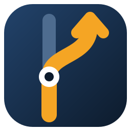
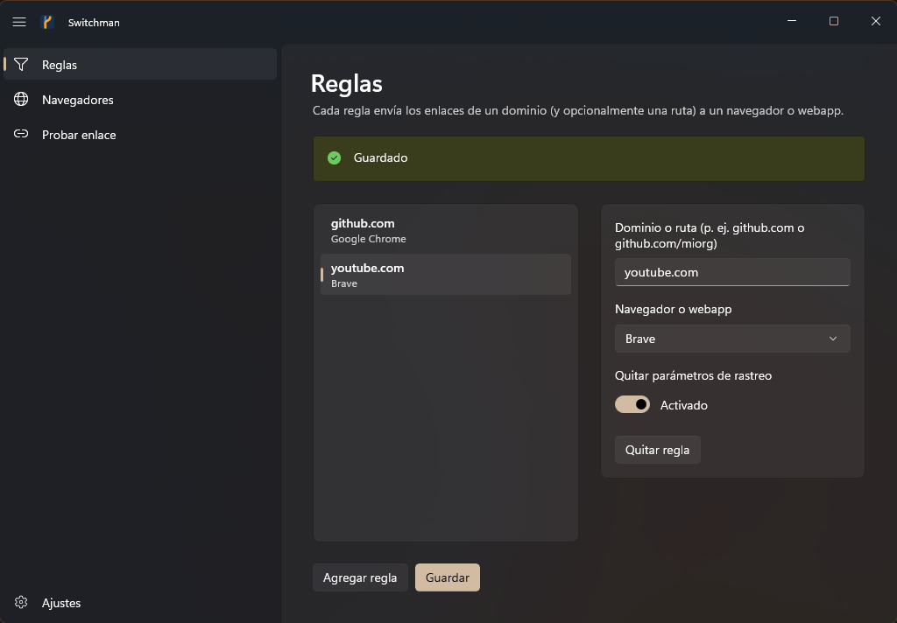
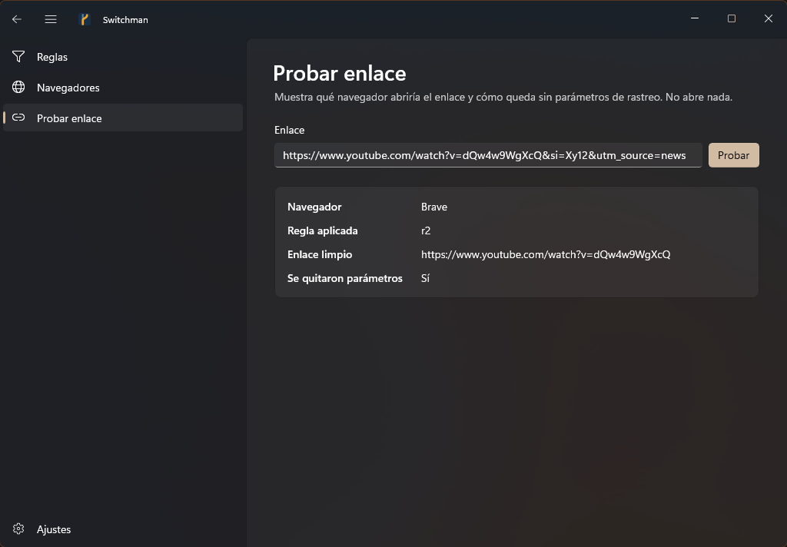

<p align="center">
  
</p>

<h1 align="center">Switchman</h1>

<p align="center">
  <b>English</b> · <a href="README.es.md">Español</a>
</p>

<p align="center">
  Every link you click on Windows goes through Switchman first: it strips the tracking
  parameters and sends the link to the browser it belongs in.
</p>

---

A railway *switchman* operates the points that decide which track a train takes. Switchman does
the same with your links. It registers itself as the default browser, so when you click a link in
Slack, Outlook, a PDF or any other app, Windows hands it to Switchman. Switchman then:

1. **Cleans it**: removes `utm_*`, `fbclid`, `gclid`, `si` and other tracking parameters, keeping
   everything else exactly as it was (no re-encoding).
2. **Routes it**: picks the browser from your rules (`github.com` → Chrome, `youtube.com` → Brave…)
   or your default browser.
3. **Opens it** in that browser and exits. Nothing stays running in the background.

No network access, no telemetry, no account. Your configuration is a local JSON file.

| Rules | Test a link |
| :---: | :---: |
|  |  |

## Features

- **Per-domain rules**, with an optional path: `github.com`, `docs.google.com/document`. A rule
  matches the domain and its subdomains (`gist.github.com`), never look-alikes (`notgithub.com`).
- **Tracking cleanup** on by default, switchable globally or per rule, with your own extra parameters.
- **Browser detection**: Edge, Chrome, Brave, Firefox, Zen, Helium and any browser registered in
  Windows. Others can be added by hand in `config.json` (`custom_browsers`).
- **Safe fallbacks**: if `config.json` is missing or damaged, links still open, in the fallback
  browser you chose (or the first one detected). A broken config never leaves you without a browser.
- **Installed web apps as destinations**: apps installed from a Chromium browser (Helium, Chrome, Edge,
  Brave → *Install app*) show up next to the browsers, e.g. "Instagram (Helium)". A rule like
  `instagram.com` → that app opens the link **inside the app window**, not in a browser tab.
- **Desktop apps by deep link**: links to WhatsApp, Discord, Teams, Telegram, Zoom, Slack, Spotify or Notion
  open in their desktop app (one switch per app), and you can add deep links for any other app that
  registers a protocol.
- **Phone Link notifications**: tapping a phone notification on Windows goes through Switchman too.
  WhatsApp opens in its desktop app, and Reddit's "download the app" page (`reddit.com/mobile/download`)
  becomes the Reddit home page instead of a help article.
- **Test without opening**: see which browser a link would go to and what the clean URL looks like.
- **Edit-safe**: if `config.json` changes while the app is open (by hand or another window), the app
  asks whether to reload or overwrite instead of silently discarding either version.
- **Per-user install**: no administrator rights, everything lives under `HKCU` and `%LOCALAPPDATA%`.

### Tracking parameters removed

Any parameter starting with `utm_`, plus:
`fbclid` `igshid` `igsh` `gclid` `gclsrc` `dclid` `gbraid` `wbraid` `srsltid` `msclkid` `twclid`
`ttclid` `li_fat_id` `yclid` `mc_cid` `mc_eid` `_hsenc` `_hsmi` `mkt_tok` `vero_id` `wickedid`
`oly_anon_id` `oly_enc_id` `rb_clickid` `s_cid` `si`.

You can add your own in **Settings → Extra parameters to remove**.

## Installation

**Requirements:** Windows 10 (1809) or Windows 11, 64-bit. Nothing else: .NET and the Windows App
SDK ship inside the package. No administrator rights needed.

1. Download `Switchman-<version>-win-x64-setup.exe` from the [latest release](../../releases/latest)
   and run it. It installs Switchman for your user in `%LOCALAPPDATA%\Programs\Switchman`, adds it
   to the Start menu and registers it as a browser.
2. On the last page, leave both boxes ticked: **Windows Settings** opens on Switchman's default-apps
   page, and **Switchman** opens too.
3. In Switchman, go to **Browsers**, pick your default browser (and, optionally, a fallback) and
   click **Save**. Add any **Rules** you want.
4. In Windows Settings, click **Set default** on Switchman. Windows only lets you make this choice
   yourself; no app can do it for you.

From now on every link goes through Switchman. The app's **Settings** page shows whether
Switchman is the default browser.

> **SmartScreen:** the installer is not code-signed yet, so Windows may show "Windows protected
> your PC" the first time. Click **More info → Run anyway**.

### Updating

Run the setup of the new version. Your configuration is kept.

### Uninstalling

**Settings → Apps → Installed apps → Switchman → Uninstall**. This removes the registration, the
Start menu shortcut and the program. Your configuration in `%LOCALAPPDATA%\Switchman` stays, in case
you reinstall; delete that folder to remove it too. Then pick another default browser in Windows
Settings.

### Without the installer (zip)

Each release also has `Switchman-<version>-win-x64.zip` with the same files and `install.ps1`.
Right-click the zip → **Properties** → tick **Unblock**, extract it and run
`powershell -ExecutionPolicy Bypass -File .\install.ps1` (add `-Uninstall` to remove it).

## Using it

The interface is in English or Spanish, following the Windows display language. To force one, set
the `SWITCHMAN_LANG` environment variable to `en` or `es`.

| Page | What it is for |
| --- | --- |
| **Rules** | Domain or path → browser, and whether to strip tracking for that rule. |
| **Browsers** | Default browser (links with no rule) and fallback browser (used if `config.json` is missing or damaged). |
| **Test link** | Paste a link and see the browser, the rule applied and the clean URL. Nothing is opened. |
| **Settings** | Tracking cleanup on/off, extra parameters, and the Windows default-browser status. |

### Opening links in installed web apps

Install the site as an app from your Chromium browser (*Install app* / *Install this site as an app*).
Switchman finds it in the Start menu and lists it under **Browsers**, so you can pick it in a rule:
`instagram.com` → **Instagram (Helium)**. Each link opens in a new window of that app.

Under the hood the app is launched as
`chrome_proxy.exe --profile-directory=Default --app-id=<id> --app-launch-url-for-shortcuts-menu-item=<url>`.
The same `{url}` placeholder works in your own `custom_browsers` entries: if an argument contains
`{url}`, the link goes there; otherwise it is appended at the end.

### Opening links in desktop apps (deep links)

Many apps (WhatsApp from the Microsoft Store, Electron apps like Discord, Teams…) register their own
protocol (`whatsapp:`, `discord:`…). On the **Apps** page each installed app from the built-in catalog
has a switch; when it is on, its web links are translated and opened in the app:

| Web link | Opens as |
| --- | --- |
| `wa.me/<number>?text=…`, `api.whatsapp.com/send?phone=…` | `whatsapp://send?phone=…&text=…` |
| `chat.whatsapp.com/<code>` | `whatsapp://chat?code=<code>` |
| `discord.gg/<code>`, `discord.com/channels/…` | `discord://-/invite/<code>`, `discord://-/channels/…` |
| `teams.microsoft.com/l/…` | `msteams:/l/…` |
| `t.me/<user>`, `t.me/+<invite>` | `tg://resolve?domain=<user>`, `tg://join?invite=<invite>` |
| `zoom.us/j/<id>?pwd=…` | `zoommtg://zoom.us/join?action=join&confno=<id>&pwd=…` |
| `app.slack.com/client/<team>/<channel>` | `slack://channel?team=…&id=…` |
| `open.spotify.com/<type>/<id>` | `spotify:<type>:<id>` |
| `notion.so/…` | `notion://www.notion.so/…` |

Your rules come first, tracking parameters are removed before translating, and a link with no app form
(for example `wa.me/message/…`) opens in the browser as usual. **Find apps** rescans the system: newly
installed catalog apps get their switch.

#### Your own deep links

For an app the catalog doesn't know, click **New deep link**:

1. **App**: pick its protocol from the ones installed on your PC (or type it). The name and a first
   template fill themselves in.
2. **Domains**: the sites whose links should go to the app, one per line (`store.steampowered.com`).
   Subdomains are included.
3. **Template**: what each link turns into. **Pass the whole link** gives `steam://{url}`;
   **Replace https:// with the protocol** gives `steam://{host}/{path}?{query}`. Adjust it to what the app
   expects, e.g. `steam://openurl/{url}`. Placeholders: `{url}` the whole link, `{host}` the domain,
   `{path}` the path, `{query}` what follows the `?` (an empty `?{query}` is dropped).
4. **Try a link**: paste a real link to see what it opens as, and **Try in the app** to open it without
   saving. Problems show up under each field as you type.

Each app has its own link format and few document it, so trying is the way to find the right template.

### Files

Everything lives in `%LOCALAPPDATA%\Switchman`:

| File | Content |
| --- | --- |
| `config.json` | Rules, default browser, cleanup options, custom browsers. |
| `fallback.json` | Browser to use if `config.json` cannot be read. |
| `switchman.log` | One line per opened link: domain, browser or app, rule, whether it was cleaned (never the full URL). |
| `switchman-ui.log` | App events and errors. |

### Command line

`switchman-cli.exe` is what Windows runs on every click. The app uses it for everything else too:

```text
switchman-cli open-url <URL>            clean, route and open (what Windows calls)
switchman-cli test-url <URL>            same decision as JSON, without opening anything
switchman-cli detect                    detected browsers as JSON
switchman-cli get-config                config.json with its revision
switchman-cli set-config --revision R   save config from stdin if nobody changed it since revision R
switchman-cli reset-config              move a damaged config.json aside as config.json.bak
switchman-cli set-fallback <ID>         set the fallback browser
switchman-cli status                    registration and default-browser status
switchman-cli apps                      deep link catalog, own deep links and other installed protocols
switchman-cli check-deeplink [--url U]  check a deep link (JSON on stdin) and what link U turns into
switchman-cli open-uri <URI>            open a URI in its app (registered, non-system protocols only)
switchman-cli register [--quiet]        register in Windows (HKCU); opens Settings unless --quiet
switchman-cli unregister                remove the registration
```

Exit codes: `0` ok, `1` error, `2` usage, `3` damaged config, `4` config changed since it was read.

## Building from source

Requirements:

- [Rust](https://rustup.rs) (stable, MSVC toolchain).
- Visual Studio Build Tools 2026 with **Desktop development with C++**, **.NET desktop build tools**
  and **WinUI application development build tools**.
- .NET 10 SDK.
- [Inno Setup 6](https://jrsoftware.org/isinfo.php), only to build the installer (`winget install JRSoftware.InnoSetup`).

```powershell
# Build and install from the source tree
powershell -ExecutionPolicy Bypass -File .\scripts\install.ps1

# Checks
cargo clippy --workspace --all-targets -- -D warnings
cargo test --workspace
dotnet test ui\Switchman.slnx

# Installer and zip -> target\dist\Switchman-<version>-win-x64-setup.exe and .zip
powershell -ExecutionPolicy Bypass -File .\scripts\package.ps1
```

### Releasing

Bump `version` in `Cargo.toml` (`[workspace.package]`) and push to `main`. The
[Release workflow](.github/workflows/release.yml) builds on Windows, runs clippy and all tests, builds
the installer and the zip and publishes release `v<version>`. If that tag already exists it does nothing. It can also be run
by hand from **Actions → Release** with `dry_run` to get both as an artifact without publishing.

### Layout

```text
core/       Rust library: tracking cleanup, rule matching, config, browser detection, registry
cli/        switchman-cli.exe, the program registered as the browser
ui/         WinUI 3 app (C#): Switchman.Core (view models, testable), Switchman.App, Switchman.Tests
assets/     icon (SVG and ICO)
installer/  Inno Setup script (per-user setup.exe, English and Spanish)
scripts/    install.ps1 and package.ps1
```

The app never reads or writes the JSON files itself: it goes through `switchman-cli`, so validation
lives in one place (Rust) and the app and the click handler always agree.
